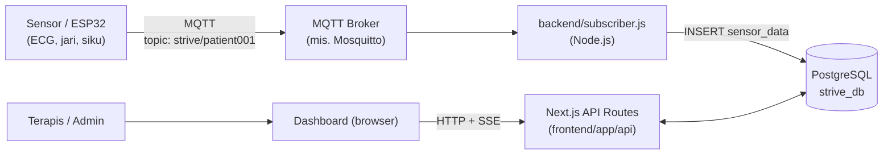
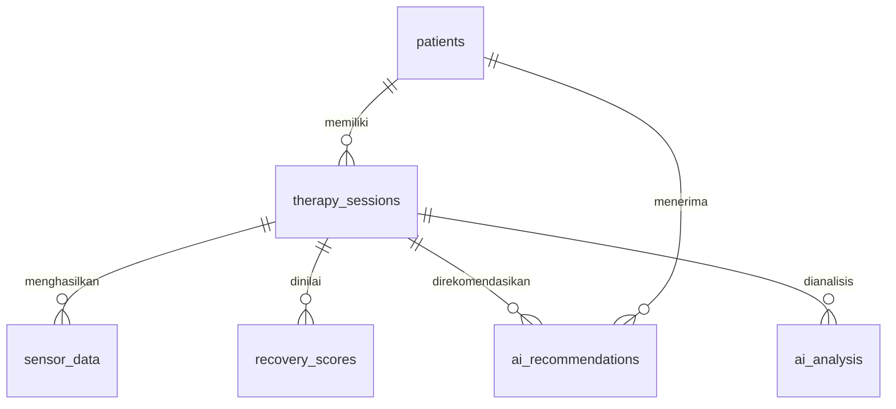

# STRIVE Monitor

**Dashboard monitoring real-time untuk rehabilitasi stroke berbasis Virtual Reality (VR).**

STRIVE Monitor menampilkan data sensor pasien (ECG, sudut jari, sudut siku) secara langsung selama sesi terapi, menyimpan riwayat sesi, menghitung skor pemulihan (*recovery score*), memberi rekomendasi terapi berbasis aturan (*rule-based*), dan menghasilkan laporan PDF per pasien.

> Dikembangkan oleh Tim STRIVE, Universitas Negeri Yogyakarta.
> Lisensi: [MIT](./LICENSE)

---

## Daftar Isi

1. [Fitur Utama](#fitur-utama)
2. [Arsitektur Sistem](#arsitektur-sistem)
3. [Tech Stack](#tech-stack)
4. [Struktur Proyek](#struktur-proyek)
5. [Prasyarat](#prasyarat)
6. [Instalasi & Menjalankan Aplikasi](#instalasi--menjalankan-aplikasi)
7. [Konfigurasi](#konfigurasi)
8. [Format Data Sensor (MQTT)](#format-data-sensor-mqtt)
9. [Skema Database](#skema-database)
10. [Alur Penggunaan](#alur-penggunaan)
11. [Logika Penilaian & Rekomendasi](#logika-penilaian--rekomendasi)
12. [Dokumentasi API](#dokumentasi-api)
13. [Autentikasi & Otorisasi](#autentikasi--otorisasi)
14. [Error Handling](#error-handling)
15. [Troubleshooting](#troubleshooting)
16. [Catatan Keamanan](#catatan-keamanan)
17. [Keterbatasan & Masalah yang Diketahui](#keterbatasan--masalah-yang-diketahui)
18. [Deployment ke Production](#deployment-ke-production)
19. [Tim & Lisensi](#tim--lisensi)

---

## Fitur Utama

- **Monitoring real-time**: grafik ECG, gauge sudut jari (0-90°) dan sudut siku (0-130°), diperbarui tiap detik lewat Server-Sent Events (SSE).
- **Manajemen sesi terapi**: tombol *Start Therapy* dan *Stop Therapy* per pasien. Satu pasien hanya boleh punya satu sesi aktif.
- **Manajemen pasien**: registrasi pasien (nama, usia, jenis kelamin, diagnosis), daftar riwayat pasien, halaman detail pasien.
- **Recovery score & rekomendasi AI**: dihitung otomatis saat sesi dihentikan, memakai rata-rata data sensor seluruh sesi.
- **Grafik progres**: tren gerakan jari, gerakan siku, dan konsistensi antar sesi.
- **Laporan PDF** per pasien (riwayat recovery dan rekomendasi).
- **Autentikasi** berbasis JWT di cookie `httpOnly`, dengan dua peran: `admin` dan `therapist`.
- **Penerimaan data sensor via MQTT** dari perangkat (mis. ESP32) ke PostgreSQL melalui layanan *subscriber*.

---

## Arsitektur Sistem



**Alur data:**

1. Perangkat sensor mem-*publish* JSON ke broker MQTT pada topic `strive/patient001`.
2. `backend/subscriber.js` menerima pesan, mencari sesi terapi yang sedang aktif (`end_time IS NULL`), lalu menyimpan data ke tabel `sensor_data`.
3. Dashboard membuka koneksi SSE ke `/api/vitals?session=<id>`. Server mem-*polling* database tiap 1 detik dan mengirim data terbaru ke browser.
4. Saat terapis menekan **Stop Therapy**, `PATCH /api/sessions` menutup sesi, menghitung rata-rata sudut, lalu menyimpan `recovery_scores` dan `ai_recommendations`.

> Aplikasi ini memakai **dua proses terpisah**: backend (`subscriber.js`) dan frontend (Next.js). Keduanya harus berjalan agar data sensor tampil di dashboard.

---

## Tech Stack

| Lapisan | Teknologi |
|---|---|
| Frontend | Next.js 14 (App Router), React 18, TypeScript, Tailwind CSS 3 |
| Visualisasi | Canvas API (ECG), SVG (gauge), Recharts (grafik progres) |
| Laporan | pdf-lib (server-side) |
| Auth | `jose` (JWT HS256), `bcryptjs` (hash password) |
| Backend | Node.js, `mqtt`, `pg`, `dotenv` |
| Database | PostgreSQL |
| Messaging | MQTT (mis. Eclipse Mosquitto) |

---

## Struktur Proyek

```
strive-app-main/
├── LICENSE
├── README.md
├── package.json               # dependensi bcryptjs & jose (lihat catatan instalasi)
├── backend/
│   ├── .env                   # konfigurasi database & MQTT untuk backend
│   ├── db.js                  # koneksi pool PostgreSQL
│   ├── subscriber.js          # subscriber MQTT -> tabel sensor_data (proses utama)
│   ├── recovery-engine.js     # logika recovery lama (tidak dijalankan otomatis)
│   ├── ai-engine.js           # rekomendasi rule-based berkala (opsional)
│   ├── dummy-data.sql         # data uji untuk skenario Good / Moderate / Poor
│   └── package.json
└── frontend/
    ├── .env.local             # DATABASE_URL & JWT_SECRET untuk Next.js
    ├── middleware.ts          # proteksi halaman & API (cek JWT)
    ├── app/
    │   ├── page.tsx           # dashboard utama
    │   ├── login/             # halaman login
    │   ├── register/          # registrasi pasien
    │   ├── users/new/         # tambah user (admin)
    │   ├── patient/[id]/      # detail pasien + unduh laporan PDF
    │   └── api/               # route handler (lihat Dokumentasi API)
    ├── components/dashboard/  # ECGMonitor, JointAngleGauge, ProgressChart, dll.
    ├── lib/
    │   ├── auth.ts            # hash password, sign/verify JWT
    │   ├── db.ts              # pool PostgreSQL + helper query()
    │   └── types.ts           # tipe data & rumus recoveryScore()
    ├── db/
    │   ├── schema.sql         # skema database + data contoh
    │   └── seed-data.ts       # data contoh (lihat catatan di Masalah yang Diketahui)
    └── scripts/seed.ts
```

---

## Prasyarat

| Kebutuhan | Versi yang disarankan |
|---|---|
| Node.js | 18.17+ (disarankan 20 LTS) |
| npm | 9+ |
| PostgreSQL | 13+ |
| MQTT broker | Mosquitto atau sejenisnya (tidak disertakan di repo) |
| Perangkat sensor | ESP32 atau simulator (opsional untuk pengembangan) |

---

## Instalasi & Menjalankan Aplikasi

### 1. Ambil kode dan pasang dependensi

```bash
git clone <url-repo-anda> strive-app
cd strive-app

# Dependensi root (bcryptjs & jose dipakai oleh frontend/lib/auth.ts)
npm install

# Frontend
cd frontend && npm install && cd ..

# Backend
cd backend && npm install && cd ..
```

> **Penting:** `bcryptjs` dan `jose` hanya terdaftar di `package.json` **root**, bukan di `frontend/package.json`. Jangan lewati `npm install` di root. Alternatif yang lebih rapi: `cd frontend && npm install bcryptjs jose`.

### 2. Siapkan database PostgreSQL

```bash
# Buat database
psql -U postgres -c "CREATE DATABASE strive_db;"

# Terapkan skema (sekaligus menambah 1 pasien contoh + 1 sesi aktif)
psql -U postgres -d strive_db -f frontend/db/schema.sql
```

`schema.sql` menambahkan pasien `P001` dan sesi terapi #1 dengan `end_time` kosong, artinya **sesi tersebut berstatus aktif**. Lihat [Troubleshooting](#troubleshooting) bila tombol *Start Therapy* menolak dengan pesan "masih punya sesi aktif".

### 3. Buat akun admin pertama

Tidak ada halaman pendaftaran publik untuk user. Endpoint `POST /api/users` hanya bisa dipakai admin yang sudah login, jadi admin pertama dibuat manual lewat SQL.

Buat hash bcrypt (jalankan dari folder `frontend` setelah `npm install`):

```bash
cd frontend
node -e "require('bcryptjs').hash('GANTI_PASSWORD_ANDA',10).then(console.log)"
```

Masukkan ke database (gunakan `psql` interaktif, atau kutip dengan tanda petik tunggal agar karakter `$` pada hash tidak diinterpretasi shell):

```sql
INSERT INTO users (full_name, email, password_hash, role)
VALUES ('Administrator', 'admin@strive.local', '<HASH_DARI_LANGKAH_SEBELUMNYA>', 'admin');
```

Setelah login sebagai admin, user berikutnya bisa dibuat lewat halaman `/users/new`.

### 4. Siapkan MQTT broker

Contoh dengan Mosquitto:

```bash
# Ubuntu / Debian
sudo apt install mosquitto mosquitto-clients
sudo systemctl enable --now mosquitto

# Uji broker berjalan (terminal 1)
mosquitto_sub -h localhost -t "strive/#" -v
```

### 5. Konfigurasi environment

Salin dan sesuaikan nilai pada dua file berikut (rincian ada di bagian [Konfigurasi](#konfigurasi)):

- `backend/.env`
- `frontend/.env.local`

### 6. Jalankan aplikasi

Buka dua terminal.

**Terminal 1: backend (subscriber MQTT)**

```bash
cd backend
npm start
```

Log yang diharapkan:

```
MQTT HOST = mqtt://localhost:1883
PostgreSQL Connected
MQTT Connected
Subscribed to strive/patient001
```

**Terminal 2: frontend (Next.js)**

```bash
cd frontend
npm run dev
```

Buka <http://localhost:3000>, lalu login dengan akun admin dari langkah 3.

### 7. Uji tanpa perangkat sensor

Pastikan ada sesi aktif (tekan **Start Therapy** di dashboard), lalu kirim data simulasi.

**Lewat MQTT** (jalur yang sama dengan perangkat asli):

```bash
mosquitto_pub -h localhost -t strive/patient001 \
  -m '{"ecg": 0.9, "finger_angle": 65, "elbow_angle": 95}'
```

**Lewat REST** (tanpa broker, hanya untuk pengujian):

```bash
curl -X POST http://localhost:3000/api/vitals \
  -H "Content-Type: application/json" \
  -d '{"sessionId": 1, "ecg": 0.9, "fingerAngle": 65, "elbowAngle": 95}'
```

**Data uji skenario Good / Moderate / Poor:** lihat `backend/dummy-data.sql`. File ini memakai `patient_id = 1` dan ID sesi `101-103` yang di-*hardcode*, jadi sesuaikan dengan ID asli di database Anda sebelum dijalankan.

### Layanan opsional: `ai-engine.js`

```bash
cd backend
node ai-engine.js
```

Layanan ini membuat satu rekomendasi baru tiap 15 detik berdasarkan `recovery_scores` terbaru. Karena sudah ada pembuatan rekomendasi otomatis saat sesi dihentikan, layanan ini **tidak wajib** dan dapat menghasilkan baris rekomendasi berulang. Lihat [Keterbatasan](#keterbatasan--masalah-yang-diketahui).

---

## Konfigurasi

### `backend/.env`

| Variabel | Contoh | Keterangan |
|---|---|---|
| `DB_HOST` | `localhost` | Host PostgreSQL |
| `DB_PORT` | `5432` | Port PostgreSQL |
| `DB_NAME` | `strive_db` | Nama database |
| `DB_USER` | `postgres` | User database |
| `DB_PASSWORD` | `<password-anda>` | Password database |
| `MQTT_HOST` | `mqtt://localhost:1883` | URL broker MQTT |

### `frontend/.env.local`

| Variabel | Contoh | Keterangan |
|---|---|---|
| `DATABASE_URL` | `postgresql://postgres:<password>@localhost:5432/strive_db` | Connection string PostgreSQL. Bila kosong, semua API mengembalikan status `disconnected`. |
| `JWT_SECRET` | *(string acak 32 byte atau lebih)* | Kunci penandatanganan JWT. **Wajib diisi.** |

Membuat `JWT_SECRET` yang kuat:

```bash
openssl rand -hex 32
```

Perubahan `.env.local` baru terbaca setelah **restart** `npm run dev` / `npm start`.

### Konstanta yang tertanam di kode

| Nilai | Lokasi | Keterangan |
|---|---|---|
| Topic MQTT `strive/patient001` | `backend/subscriber.js` | Satu topic tetap untuk semua data |
| Masa berlaku token 8 jam | `lib/auth.ts`, `api/auth/login` | JWT dan cookie `strive_token` |
| Interval polling SSE 1 detik | `api/vitals/route.ts` | Frekuensi pembaruan dashboard |
| Maksimum sudut jari 90° / siku 130° | `app/page.tsx`, `api/patients/route.ts` | Normalisasi ke persen |
| Interval `ai-engine` 15 detik | `backend/ai-engine.js` | Hanya bila layanan dijalankan |
| Hash bcrypt cost 10 | `lib/auth.ts` | Putaran hashing password |

---

## Format Data Sensor (MQTT)

Perangkat harus mem-*publish* **JSON** ke topic `strive/patient001`:

```json
{
  "ecg": 0.92,
  "finger_angle": 65.4,
  "elbow_angle": 98.1
}
```

| Field | Tipe | Rentang yang diharapkan | Keterangan |
|---|---|---|---|
| `ecg` | number | skala milivolt | Nilai ECG sesaat |
| `finger_angle` | number | 0-90 (derajat) | Sudut fleksi jari |
| `elbow_angle` | number | 0-130 (derajat) | Sudut siku |

Perilaku subscriber:

- Data **hanya disimpan bila ada sesi terapi aktif**. Tanpa sesi aktif, pesan diabaikan dan dicatat di log.
- Data disimpan ke sesi aktif **terbaru** (`end_time IS NULL ORDER BY id DESC LIMIT 1`) secara global. Bila ada lebih dari satu pasien yang sesinya aktif bersamaan, semua data masuk ke sesi yang paling baru dibuat.
- Field yang hilang tersimpan sebagai `NULL`. Tidak ada validasi rentang nilai.
- Firmware perangkat tidak termasuk dalam repositori ini.

---

## Skema Database

Didefinisikan di `frontend/db/schema.sql`.

| Tabel | Fungsi | Kolom penting |
|---|---|---|
| `patients` | Data pasien | `patient_code` (unik), `full_name`, `age`, `gender`, `diagnosis` |
| `therapy_sessions` | Sesi terapi | `patient_id`, `start_time`, `end_time` (kosong = aktif), `stage`, `status`, `notes` |
| `sensor_data` | Data sensor mentah | `session_id`, `ecg`, `finger_angle`, `elbow_angle`, `created_at` |
| `recovery_scores` | Skor pemulihan per sesi | `session_id`, `score`, `level`, `recommendation` |
| `ai_recommendations` | Rekomendasi terapi | `patient_id`, `session_id`, `recommendation`, `source` |
| `ai_analysis` | Disiapkan untuk analisis LLM | `prompt`, `response`, `model_name` (belum dipakai kode) |
| `users` | Akun login | `full_name`, `email` (unik), `password_hash`, `role` |



> Aplikasi menentukan sesi aktif dari `end_time IS NULL`. Kolom `status` (default `'ACTIVE'`) tidak diperbarui saat sesi ditutup.

---

## Alur Penggunaan

1. **Login** di `/login`.
2. **Tambah pasien** lewat tombol *+ Tambah Pasien* (modal) atau halaman `/register`.
3. **Pilih pasien** dari daftar *Riwayat Pasien*.
4. Tekan **Start Therapy**. Server membuat sesi baru. Bila pasien masih punya sesi aktif, server menolak dengan status 409.
5. **Monitoring**: perangkat mengirim data via MQTT, dashboard menampilkan ECG dan sudut jari/siku.
6. Tekan **Stop Therapy**. Server menutup sesi, menghitung recovery score, dan menyimpan rekomendasi.
7. Lihat **grafik progres**, **recovery score**, dan **rekomendasi AI** pada dashboard.
8. Buka **Detail** pasien (`/patient/<id>`) untuk riwayat sesi dan tombol **Download Report PDF**.

---

## Logika Penilaian & Rekomendasi

Ada dua perhitungan berbeda yang tampil di dashboard.

### A. Recovery level (disimpan saat Stop Therapy)

Dihitung di `PATCH /api/sessions` dari **rata-rata** `finger_angle` dan `elbow_angle` seluruh sesi, lalu disimpan ke `recovery_scores` dan `ai_recommendations`:

| Kondisi (rata-rata) | Score | Level | Rekomendasi |
|---|---|---|---|
| jari > 60° **dan** siku > 90° | 90 | Good | Pasien menunjukkan perkembangan sangat baik. |
| jari > 30° **dan** siku > 45° | 70 | Moderate | Lanjutkan terapi Stage 2. |
| selain itu | 40 | Poor | Fokus latihan ROM dasar. |
| tidak ada data sensor | 0 | Poor | Belum ada data sensor yang cukup. |

Kartu **Recovery** di baris ringkasan dan kotak **AI Recommendation** membaca hasil ini dari sesi terakhir pasien. Nilainya baru muncul setelah ada sesi yang dihentikan.

### B. Recovery Score komposit (kartu "Recovery Score")

Dihitung di `lib/types.ts` dari tiga persentase milik sesi terakhir:

```
Recovery Score = 35% × gerakan jari + 35% × gerakan siku + 30% × konsistensi
```

| Komponen | Cara hitung (`api/patients`) |
|---|---|
| Gerakan jari (%) | rata-rata `finger_angle` ÷ 90 × 100, dibatasi 0-100 |
| Gerakan siku (%) | rata-rata `elbow_angle` ÷ 130 × 100, dibatasi 0-100 |
| Konsistensi (%) | 100 − ((stddev jari + stddev siku) ÷ (rata-rata jari + rata-rata siku)) × 100, dibatasi 0-100. Bila sampel < 2, nilainya 0. |

> Rekomendasi bersifat **rule-based sederhana**, bukan model machine learning, dan bukan pengganti penilaian klinis tenaga medis.

---

## Dokumentasi API

Semua respons JSON memiliki field `status` (`ok`, `connected`, `disconnected`, atau `error`). Kolom **Proteksi** menunjukkan apakah route tercakup `middleware.ts`.

| Method | Endpoint | Proteksi | Fungsi |
|---|---|---|---|
| POST | `/api/auth/login` | Publik | Login, set cookie `strive_token` |
| POST | `/api/auth/logout` | Publik | Hapus cookie |
| GET | `/api/auth/me` | Cek token sendiri | Info user yang login |
| POST | `/api/users` | Login + role `admin` | Buat user baru |
| POST | `/api/register` | **Tidak tercakup middleware** | Registrasi pasien |
| GET | `/api/patients` | Login | Daftar pasien + sesi + metrik |
| GET | `/api/patients/:id` | Login | Detail pasien + riwayat sesi |
| POST | `/api/sessions` | Login | Mulai sesi terapi |
| PATCH | `/api/sessions` | Login | Hentikan sesi + hitung recovery |
| GET | `/api/dashboard?patientId=` | Login | Ringkasan dashboard pasien |
| GET | `/api/vitals?session=` | **Tidak tercakup middleware** | Stream SSE data sensor |
| POST | `/api/vitals` | **Tidak tercakup middleware** | Input data sensor manual (testing) |
| GET | `/api/report/:id` | Login | Unduh laporan PDF |

### Contoh request

**Login**

```bash
curl -i -c cookies.txt -X POST http://localhost:3000/api/auth/login \
  -H "Content-Type: application/json" \
  -d '{"email":"admin@strive.local","password":"GANTI_PASSWORD_ANDA"}'
```

```json
{ "status": "ok" }
```

**Registrasi pasien** (`POST /api/register`)

```json
// request
{ "name": "Bapak Contoh", "age": 60, "gender": "Laki-laki", "diagnosis": "Stroke Iskemik" }
// response
{ "status": "ok", "patientId": 2 }
```

**Mulai sesi** (`POST /api/sessions`)

```bash
curl -b cookies.txt -X POST http://localhost:3000/api/sessions \
  -H "Content-Type: application/json" \
  -d '{"patientId": 2, "stage": 1, "notes": "Therapy started"}'
```

```json
{ "status": "ok", "sessionId": 5 }
```

**Hentikan sesi** (`PATCH /api/sessions`)

```bash
curl -b cookies.txt -X PATCH http://localhost:3000/api/sessions \
  -H "Content-Type: application/json" \
  -d '{"sessionId": 5, "notes": "Therapy finished"}'
```

```json
{
  "status": "ok",
  "sessionId": 5,
  "recovery": {
    "score": 70,
    "level": "Moderate",
    "recommendation": "Lanjutkan terapi Stage 2.",
    "sampleCount": 128
  }
}
```

**Stream sensor** (`GET /api/vitals?session=5`): tiap pesan SSE berbentuk `data: {...}`:

| `status` | Arti | Field tambahan |
|---|---|---|
| `ok` | Ada data sensor | `ecg`, `finger_angle`, `elbow_angle`, `created_at` |
| `waiting` | Sesi ada tetapi belum ada data sensor | - |
| `disconnected` | `DATABASE_URL` belum diisi | - |
| `error` | Query database gagal | `message` |

**Kirim data manual** (`POST /api/vitals`): field `sessionId` wajib; `ecg`, `fingerAngle`, `elbowAngle` opsional (disimpan `NULL` bila kosong). Sukses mengembalikan status HTTP 201.

---

## Autentikasi & Otorisasi

- Login memverifikasi password dengan bcrypt, lalu menerbitkan JWT (HS256, kedaluwarsa 8 jam) yang disimpan di cookie `strive_token` dengan atribut `httpOnly`, `sameSite=lax`, dan `secure` (hanya saat `NODE_ENV=production`).
- `middleware.ts` memeriksa cookie pada route yang tercakup `matcher`. Bila token tidak valid, pengguna **dialihkan (redirect) ke `/login`**. Untuk route API, ini berarti klien menerima redirect/HTML, bukan JSON 401.
- Cakupan middleware: `/`, `/register`, `/users/*`, `/api/patients/*`, `/api/sessions/*`, `/api/dashboard/*`, `/api/report/*`, `/api/users/*`.
- **Tidak tercakup:** `/patient/[id]`, `/api/register`, `/api/vitals`. Lihat [Catatan Keamanan](#catatan-keamanan).
- Otorisasi peran hanya diterapkan di `POST /api/users` (wajib `admin`). Role `therapist` dan `admin` memiliki akses sama pada fitur lainnya.

---

## Error Handling

### Prinsip umum

- Semua API route mengembalikan JSON dengan `status` dan (bila gagal) `message`.
- Pesan error dari PostgreSQL diteruskan apa adanya ke `message`. Ini membantu debugging, namun sebaiknya disamarkan di production.
- Backend tidak berhenti saat terjadi error; error dicatat ke konsol (`console.log`) dan proses tetap berjalan.

### Kode status HTTP per endpoint

| Kode | Kapan terjadi | Endpoint |
|---|---|---|
| 200 | Sukses; juga dipakai `/api/patients` saat DB belum dikonfigurasi (`status: "disconnected"`) | Semua |
| 201 | Sesi dibuat / data sensor tersimpan | `POST /api/sessions`, `POST /api/vitals` |
| 400 | Field wajib kosong (`email`/`password`, `name`, `patientId`, `sessionId`, query `session`) | Login, register, sessions, vitals, users |
| 401 | Email atau password salah; token tidak valid | `/api/auth/login`, `/api/auth/me` |
| 403 | Bukan admin | `POST /api/users` |
| 404 | Pasien tidak ditemukan | `/api/patients/:id`, `/api/report/:id` |
| 409 | Pasien masih punya sesi aktif (respons menyertakan `sessionId`) | `POST /api/sessions` |
| 500 | Error database / server (pesan di `message`) | Hampir semua |
| 503 | `DATABASE_URL` belum diisi | `/api/dashboard`, `/api/sessions`, `/api/patients/:id`, `/api/vitals` (POST) |

### Penanganan di dashboard (frontend)

Halaman utama punya lima status tampilan:

| Status UI | Penyebab | Yang ditampilkan |
|---|---|---|
| `loading` | Menunggu `/api/patients` | "Memuat data pasien..." |
| `disconnected` | `DATABASE_URL` kosong | "Belum terhubung ke database" + instruksi mengisi `.env.local` |
| `error` | API gagal / jaringan putus | "Gagal mengambil data" + pesan error |
| `empty` | Belum ada pasien | Sambutan + tombol tambah pasien |
| `connected` | Normal | Dashboard lengkap |

Komponen real-time (`ECGMonitor`, `JointAngleGauge`) menampilkan keterangan sesuai status SSE:

| Status | Teks di UI | Penyebab |
|---|---|---|
| `empty` | belum ada sesi terapi | Pasien belum punya sesi |
| `waiting` | menunggu sensor | Sesi ada, belum ada data masuk |
| `disconnected` | DB terputus | `DATABASE_URL` kosong |
| `error` | terputus | Koneksi SSE gagal atau query error |

### Penanganan di backend (`subscriber.js`)

| Situasi | Perilaku |
|---|---|
| Gagal terhubung ke broker | Event `error` dicatat (`MQTT ERROR: ...`). Klien `mqtt` mencoba menyambung ulang otomatis dan subscribe ulang saat tersambung kembali. |
| Gagal subscribe | Dicatat sebagai `Subscribe Error`. |
| Payload bukan JSON valid | Ditangkap `try/catch`, dicatat `ERROR:`, pesan dibuang. |
| Tidak ada sesi aktif | Pesan diabaikan, dicatat "Tidak ada sesi terapi aktif...". |
| Gagal insert ke DB | Ditangkap `try/catch`, dicatat; data pesan itu hilang (tidak ada *retry*/antrean). |
| Gagal koneksi awal PostgreSQL (`db.js`) | Dicatat `DB ERROR:`; proses tidak berhenti, query berikutnya akan gagal sampai database tersedia. |

### Celah penanganan error yang perlu diketahui

- `POST /api/auth/login`: query database berada di luar `try/catch`. Jika database mati, respons 500 tidak berbentuk JSON dan halaman login gagal membaca respons tanpa menampilkan pesan.
- `GET /api/report/:id`: tidak ada `try/catch` maupun pengecekan `isDbConfigured()`. ID non-numerik atau database mati menghasilkan error 500 default Next.js.
- `/patient/[id]` adalah *server component* tanpa `try/catch`; error database menampilkan halaman error Next.js.
- `PATCH /api/sessions` tidak memeriksa apakah `sessionId` ada atau sudah ditutup sebelumnya. Memanggilnya dua kali menambah baris `recovery_scores` dan `ai_recommendations` ganda.
- Tombol Start/Stop memakai `alert()` dan `console.error`; kegagalan jaringan pada Start/Stop hanya tercatat di konsol browser.

---

## Troubleshooting

### Database & konfigurasi

| Gejala | Kemungkinan penyebab | Solusi |
|---|---|---|
| Dashboard: "Belum terhubung ke database" | `DATABASE_URL` kosong atau Next.js belum di-restart | Isi `frontend/.env.local`, lalu restart `npm run dev` |
| "Gagal mengambil data": `relation "patients" does not exist` | Skema belum diterapkan | `psql -U postgres -d strive_db -f frontend/db/schema.sql` |
| `database "strive_db" does not exist` | Database belum dibuat | `psql -U postgres -c "CREATE DATABASE strive_db;"` |
| `password authentication failed for user "postgres"` | Password di env salah | Samakan `DB_PASSWORD` / `DATABASE_URL` dengan password PostgreSQL |
| `connect ECONNREFUSED 127.0.0.1:5432` | PostgreSQL tidak berjalan atau port berbeda | Nyalakan PostgreSQL, cek `DB_PORT` |
| Backend: `DB ERROR: ...` saat start | Kredensial `backend/.env` salah | Periksa nilai `DB_*` |

### Login & sesi

| Gejala | Kemungkinan penyebab | Solusi |
|---|---|---|
| "Email atau password salah." | User belum ada, atau hash di database salah | Buat user sesuai [langkah 3](#3-buat-akun-admin-pertama); pastikan kolom `password_hash` berisi hash bcrypt (60 karakter) |
| Klik "Masuk" tidak terjadi apa-apa, tanpa pesan | Server mengembalikan 500 non-JSON (umumnya database mati) | Lihat log terminal Next.js, perbaiki koneksi database |
| Login terus kembali ke `/login` | `JWT_SECRET` kosong sehingga token tidak bisa dibuat/diverifikasi | Isi `JWT_SECRET` di `.env.local`, restart |
| Login lancar di `npm run dev`, tetapi gagal setelah `npm start` dibuka lewat `http://<IP-LAN>` | Cookie ber-flag `secure` pada production tidak dikirim lewat HTTP biasa (kecuali `localhost`) | Pakai HTTPS (reverse proxy), atau akses lewat `localhost` |
| 403 "Hanya admin yang bisa menambah user." | Akun yang login berstatus `therapist` | Login sebagai admin, atau ubah `role` di tabel `users` |
| `Module not found: Can't resolve 'bcryptjs'` atau `'jose'` | `npm install` di root terlewat | Jalankan `npm install` di root, atau `cd frontend && npm i bcryptjs jose` |

### Sesi terapi & data sensor

| Gejala | Kemungkinan penyebab | Solusi |
|---|---|---|
| Start Therapy: "Pasien ini masih punya sesi aktif (#N)" | Ada sesi dengan `end_time` kosong (mis. sesi contoh dari `schema.sql`) | Tekan **Stop Therapy**, atau jalankan `UPDATE therapy_sessions SET end_time = NOW() WHERE id = N;` |
| Log backend: "Tidak ada sesi terapi aktif, data sensor diabaikan." | Perangkat mengirim data sebelum **Start Therapy** ditekan | Mulai sesi dulu, baru kirim data |
| Dashboard terus "menunggu sensor" | Belum ada baris `sensor_data` untuk sesi tersebut | Cek `subscriber.js` berjalan, topic tepat `strive/patient001`, broker hidup, dan ada sesi aktif |
| Log backend: `MQTT ERROR: connect ECONNREFUSED` | Broker MQTT mati atau `MQTT_HOST` salah | Nyalakan Mosquitto, cek `MQTT_HOST` |
| Log backend: `SyntaxError: Unexpected token ... in JSON` | Payload bukan JSON | Kirim JSON sesuai [format data sensor](#format-data-sensor-mqtt) |
| Sudut jari/siku tampil, tetapi grafik ECG datar | Lihat [Masalah yang Diketahui](#keterbatasan--masalah-yang-diketahui) no. 1 | - |
| Kartu Recovery dan AI Recommendation menampilkan "-" | Belum ada sesi yang dihentikan, sehingga `recovery_scores` kosong | Tekan **Stop Therapy** setidaknya sekali |
| Data masuk ke pasien yang salah | Subscriber menulis ke sesi aktif terbaru secara global | Pastikan hanya satu sesi aktif pada satu waktu |

### Lainnya

| Gejala | Penyebab | Solusi |
|---|---|---|
| `npm run seed` gagal | Skrip `seed.ts` memakai nama kolom yang tidak ada di `schema.sql` | Gunakan data contoh di `schema.sql` / `backend/dummy-data.sql` |
| Port 3000 sudah dipakai | Aplikasi lain berjalan | `npm run dev -- -p 3001` |
| Unduh PDF: "Patient not found" | ID pasien tidak ada | Gunakan ID dari tabel `patients` |
| Unduhan PDF menghasilkan error 500 | ID bukan angka, atau database mati | Periksa URL dan koneksi database |

---

## Catatan Keamanan


1. **Rahasia ikut tersimpan di repositori.** `backend/.env` berisi password database dan tidak tercakup `.gitignore` (yang hanya ada di folder `frontend`). `frontend/.env.local` berisi `JWT_SECRET` dan password database. Jika repositori pernah dipublikasikan, **ganti** password database dan `JWT_SECRET`, lalu tambahkan `.env` ke `.gitignore` di root.
2. **Password database di-hardcode** pada `frontend/api.ts` (file ini tidak terpakai sebagai route dan sebaiknya dihapus).
3. **Log debug membocorkan data sensitif:**
   - `api/auth/login` mencetak email, **password plaintext**, dan hash dari database.
   - `api/users` mencetak nilai token JWT.
   - `lib/db.ts` mencetak `DATABASE_URL` (termasuk password) pada setiap pengecekan.
   Hapus semua log ini.
4. **Route tanpa proteksi login:** `/api/register`, `/api/vitals` (GET dan POST), dan halaman `/patient/[id]`. Siapa pun yang dapat menjangkau server bisa membuat pasien, membaca data sensor, atau menyuntikkan data sensor palsu. Tambahkan route tersebut ke `matcher` di `middleware.ts`, dan pertimbangkan API key untuk jalur perangkat.
5. **MQTT tanpa autentikasi dan tanpa TLS** pada konfigurasi bawaan. Aktifkan username/password dan TLS pada broker untuk jaringan non-lokal.
6. **Tidak ada pembatasan percobaan login** (*rate limiting*).
7. **Pesan error database diteruskan ke klien**, yang dapat membuka detail struktur database.
8. Role `therapist` dan `admin` memiliki akses yang sama kecuali pembuatan user.

---

## Keterbatasan & Masalah yang Diketahui


1. **ECG tidak tergambar.** `ECGMonitor.tsx` membaca `data.ecg_mv`, sedangkan `/api/vitals` mengirim field `ecg`. Akibatnya buffer gelombang tidak pernah terisi. Perbaikan: samakan nama field di salah satu sisi. Perhitungan BPM pada komponen yang sama juga tampak belum tepat (hasil `Math.round(60000 / avgMs) * 6`) dan perlu diverifikasi.
2. **`recovery-engine.js` tidak melakukan apa pun saat dijalankan.** Fungsi `calculateRecovery()` didefinisikan tetapi tidak pernah dipanggil. Logika yang sama kini ada di `PATCH /api/sessions`, sehingga berkas ini kemungkinan peninggalan versi lama.
3. **`npm start` di backend hanya menjalankan `subscriber.js`.** `ai-engine.js` harus dijalankan manual dan, bila dijalankan, menyimpan rekomendasi baru tiap 15 detik tanpa pengecekan duplikasi.
4. **`scripts/seed.ts` tidak sinkron dengan `schema.sql`.** Skrip memakai kolom seperti `patients.name`, `therapy_sessions.started_at`, `duration_min`, dan ID bertipe teks (`PT-001`) yang tidak ada di skema, sehingga `npm run seed` akan gagal. `db/seed-data.ts` juga dipakai sebagai referensi tipe di `lib/types.ts`.
5. **Deduplikasi SSE kemungkinan tidak berfungsi.** `api/vitals` membandingkan `created_at` dengan `===`; jika driver `pg` mengembalikan objek `Date`, perbandingan selalu salah sehingga baris terakhir dikirim ulang tiap detik walau belum ada data baru.
6. **Tiga koneksi SSE per halaman** (satu untuk ECG, satu per gauge), masing-masing mem-*polling* database tiap detik. Untuk banyak pengguna, pertimbangkan satu koneksi bersama atau `LISTEN/NOTIFY`.
7. **Topic MQTT tunggal** (`strive/patient001`) dan penulisan ke sesi aktif terbaru membuat sistem ini hanya cocok untuk satu pasien aktif per waktu.
8. **Fungsi `downloadPDF()` di `app/page.tsx` tidak terpakai** (dan akan gagal karena `/api/report/:id` mengembalikan PDF, bukan JSON). Unduh laporan dilakukan lewat tombol di halaman detail pasien.
9. **Laporan PDF sederhana:** satu halaman, tanpa pemotongan baris panjang atau halaman tambahan, sehingga riwayat yang sangat panjang dapat keluar dari halaman.
10. Tombol di `/register` berlabel "Simpan & Mulai Terapi", tetapi registrasi tidak lagi memulai sesi otomatis (sesi dimulai manual lewat Start Therapy).
11. Tabel `ai_analysis`, kolom `recovery_scores.confidence`, dan `therapy_sessions.status` belum dipakai logika aplikasi.
12. Belum ada pengujian otomatis (unit/integrasi) maupun konfigurasi Docker.

---

## Deployment ke Production

```bash
cd frontend
npm run build
npm start          # default port 3000
```

Checklist minimum:

- [ ] `NODE_ENV=production` dan `JWT_SECRET` baru yang kuat.
- [ ] Layani lewat **HTTPS** (mis. Nginx/Caddy sebagai reverse proxy). Cookie login ber-flag `secure` pada production.
- [ ] Untuk SSE di balik Nginx, nonaktifkan buffering pada `/api/vitals` (`proxy_buffering off;`) agar data tidak tertahan.
- [ ] Jalankan `backend/subscriber.js` sebagai layanan yang dikelola (systemd atau PM2) agar otomatis hidup kembali.
- [ ] Amankan broker MQTT (autentikasi + TLS) dan batasi akses jaringan ke PostgreSQL.
- [ ] Selesaikan butir di [Catatan Keamanan](#catatan-keamanan).
- [ ] Atur *backup* berkala database `strive_db`.

Contoh PM2:

```bash
npm i -g pm2
pm2 start backend/subscriber.js --name strive-subscriber
pm2 start "npm start" --name strive-web --cwd frontend
pm2 save
```

---

## Tim & Lisensi

**Pengembang:** Zalfa Deizrantio Hamboro, Sepi Ananda (Tim STRIVE, Universitas Negeri Yogyakarta).

Dirilis di bawah [Lisensi MIT](./LICENSE). Hak cipta © 2026 Zalfa Deizrantio Hamboro; Sepi Ananda.

> **Disclaimer:** STRIVE Monitor adalah alat bantu pemantauan dan tidak dimaksudkan menggantikan diagnosis atau keputusan klinis tenaga kesehatan profesional.
